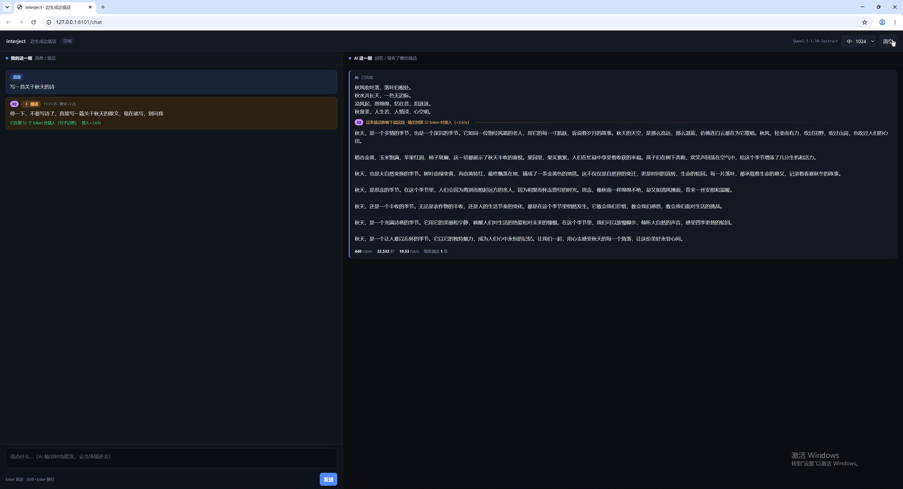
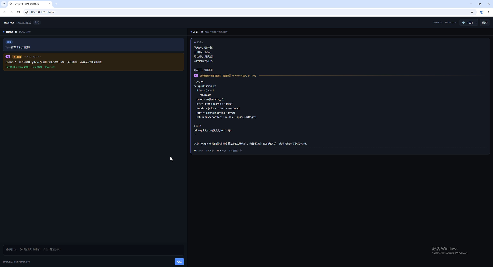
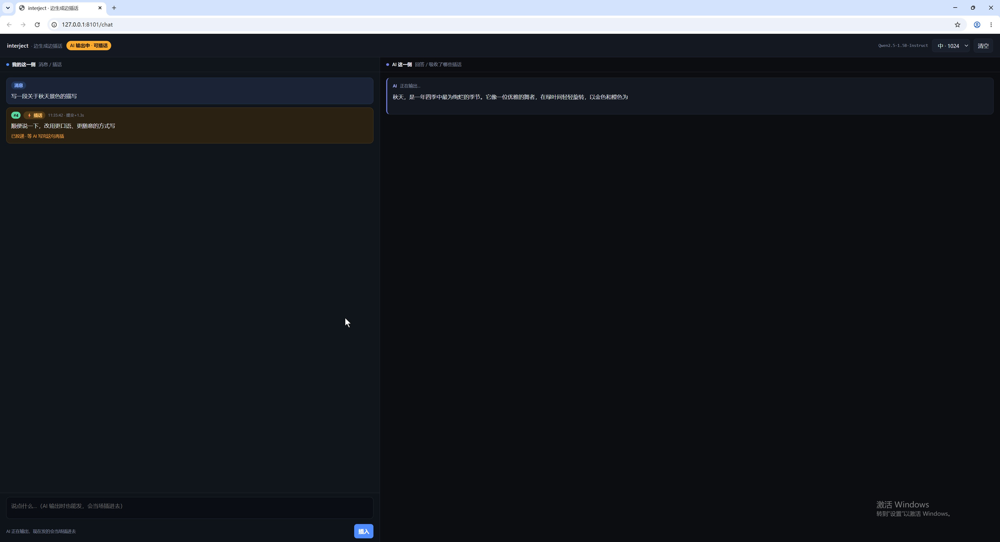
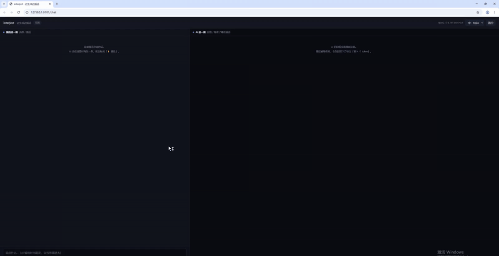

# interject — talk to a model while it's still writing

**English** · [中文](README.zh-CN.md)

> You can speak up while the model is still generating. It doesn't restart, doesn't recompute — it just changes course.

Chat is turn-based: you speak, the model speaks, you speak again. This tears out the wall in the middle.
While the model is emitting tokens you can drop in a message at any point; it gets appended straight to
the sequence being decoded, and the next forward pass folds it into the KV cache.
**No pause, no recompute, no new turn.**

<p align="center">
  
</p>

## What it solves

| The old way | The cost | interject |
|---|---|---|
| Wait for it to finish, then correct it | Tens of seconds wasted, and the wrong part still needs rewriting | Say one line mid-stream, it turns on the spot |
| Interrupt and restart | Everything generated is discarded, the KV cache is rebuilt | What's already written stays; only what follows changes |
| Bury the instruction in the system prompt | Distant instructions decay, small models ignore them | The instruction rides along with the message, right in front of the model |

## Quick start

```bash
git clone <this-repo>
cd interject
pip install -r requirements.txt

# drop in any HuggingFace causal LM
# models/qwen2.5-1.5b/  <- Qwen/Qwen2.5-1.5B-Instruct
python -m interject.server --port 8100 --model ./models/qwen2.5-1.5b
```

Open <http://127.0.0.1:8100/chat>.

1. Send `写一首关于秋天的诗` ("write a poem about autumn")
2. It starts streaming — **the input box stays live**, the send button becomes "insert"
3. Type `停一下，不要写诗了，改成写一篇散文` ("stop, drop the poem, write an essay instead") and hit enter
4. An amber card appears on the left, tagged `#1 · 11:21:33 · +1.2s`
5. The model doesn't stop. It finishes the current sentence, splices your line in, and the reply is
   **split into segments**, each marked with which message shaped it

Windows: `run.ps1`. Linux/macOS: `run.sh`.

## How it works, in three lines

```python
for step in range(max_new_tokens):
    # 1. check the queue every step; never block generation
    # 2. at a sentence boundary, splice the message into the sequence
    input_ids = torch.cat([input_ids, piece], dim=-1)

    # 3. forward as usual, feeding only the tokens added since last pass
    outputs = model(input_ids[:, past_len:], past_key_values=past, use_cache=True)
```

`past_key_values` holds the already-computed prefix. To the model, the spliced tokens are simply new
tokens; the next forward pass computes only those. So the model meets your message **inside one
continuous reasoning pass**, not after a restart.

This means writing the decode loop yourself — `model.generate()` gives you no way to change
`input_ids` mid-flight. Details in [docs/ARCHITECTURE.md](docs/ARCHITECTURE.md).

## How well it works

Same prompt — "write a poem about autumn" — switching to prose mid-stream. Qwen2.5-1.5B, fixed seed:

| Insertion point | Result | Avg line length |
|---|---|---|
| none (baseline) | a 20-line poem | 9.8 |
| token 14 | clean switch, and it says so: "OK, I understand, here is an essay" | 39.8 |
| token 49 | switches, with four lines of poem left in front | 30.1 |
| token 101 | the genre slides over, but it **never realises** it changed tasks | 18.8 |

Average line length turned out to be a useful proxy for the switch: poetry is short lines (~10 chars),
prose is long ones (~40), and the half-converted case lands in between.

Cross-domain works too: inject "write a Python quicksort" at token 26 and it emits runnable code three
lines into the poem.

Full data, failure cases and method: [docs/EXPERIMENTS.md](docs/EXPERIMENTS.md).

<table>
<tr>
<td width="50%"><br><sub>Poem → Python mid-stream; the reply is cut at the insertion point</sub></td>
<td width="50%"><br><sub>Message delivered, waiting for the model to finish its sentence</sub></td>
</tr>
</table>

## Demo



34 seconds, a real run on the 1.5B model: it starts writing a poem about autumn, a message arrives at
token 45 asking for prose instead, and the model picks it up after the next full stop and turns.
Raw recording: [`assets/demo.mp4`](assets/demo.mp4).

## Three limitations you should know

1. **No undo.** Everything before the insertion point stays. You get "half a poem + an essay", not a
   clean essay. Real rewriting needs rollback truncation — drop the generated tail and resample.
2. **Model capability is a hard floor.** A 64M model receives the message and ignores it outright.
   1.5B understands, but gets sluggish when you insert late. It's genuinely usable from 7B up.
3. **Local models only.** Mainstream APIs are "fixed input → streaming output"; there is no hook for
   mutating the sequence mid-generation.

## Parameters

The ones that actually change how it feels:

| Parameter | Default | What it does |
|---|---|---|
| `supplement_style` | `brief` | Wording. `plain` is bare; `brief` adds "acknowledge this, then comply"; `strict` is harder |
| `max_wait_tokens` | 24 | If no sentence end arrives, wait at most this many tokens, then force a full stop |
| `soft_after` | 8 | Whether a comma counts as a break: accept it after this many tokens |
| `temperature` | 0.75 | 0.75 plus a light repetition penalty is steadier on small models |

`supplement_style` is measured, not guessed. Inserting very late, `plain` got the model to acknowledge
the task change in 1 of 3 seeds; `brief` got 3 of 3. The same instruction placed in a system prompt
failed entirely — the model learned only to say "please wait, I will write that for you" and then emit
EOS without writing anything.

## Tests

```bash
# pure logic, no model or GPU needed
pytest tests/ -m "not live"

# needs a local model and a GPU
pytest tests/ -m live
```

## Layout

```
interject/
├── interject/
│   ├── runtime.py        # decode loop + injection (the core; torch/transformers only)
│   ├── server.py         # FastAPI + SSE single-session demo
│   └── webui/chat.html   # two-column UI
├── experiments/          # task switch / wording / stability experiments
├── tests/                # unit tests (no model) + integration tests (model)
├── docs/
│   ├── ARCHITECTURE.md   # implementation notes and the four pitfalls
│   ├── EXPERIMENTS.md    # data, failure cases, method
│   └── legacy/           # earlier validation on 26M/64M models
└── assets/               # screenshots, recording, demo drivers
```

## Tested on

| | |
|---|---|
| OS | Windows 11 (Linux/macOS equally fine — no platform-specific code) |
| GPU | RTX 3060, 12 GB |
| Python | 3.11 |
| torch | 2.9.1 + CUDA 13.0 |
| transformers | 4.57.6 |
| Model | Qwen2.5-1.5B-Instruct, fp16, 4.3 GB peak VRAM |

## Background

This started as a validation of "can you inject external perception into a running inference" on 26M/64M
models. The mechanism worked; the model couldn't act on it. The full record — four controlled groups, a
LoRA fine-tune that failed to teach adoption, and the conclusion that the bottleneck is model capability
rather than the framework — is in [docs/legacy/MINIMIND-REPORT.md](docs/legacy/MINIMIND-REPORT.md).
Swapping in Qwen2.5-1.5B, the same code produced a visible difference immediately.

## License

MIT