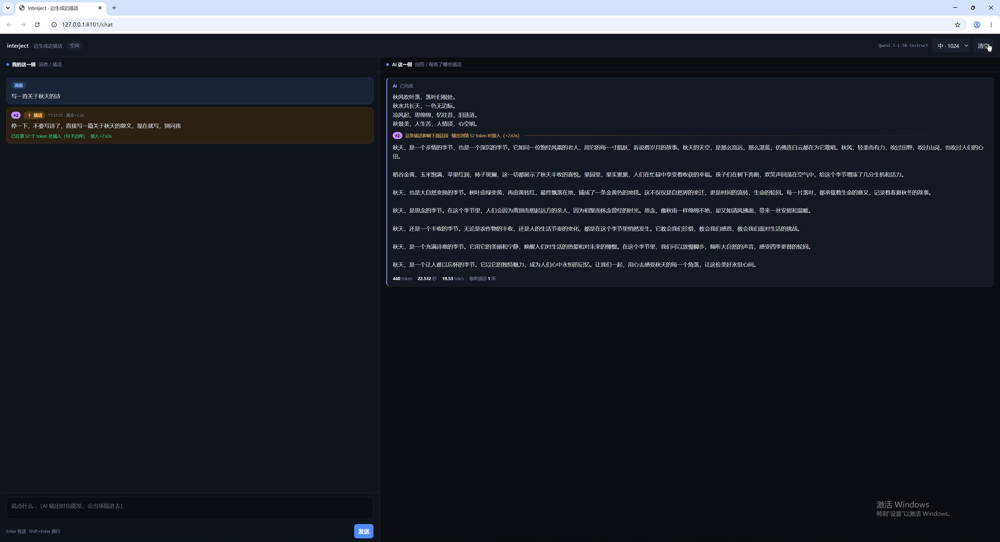
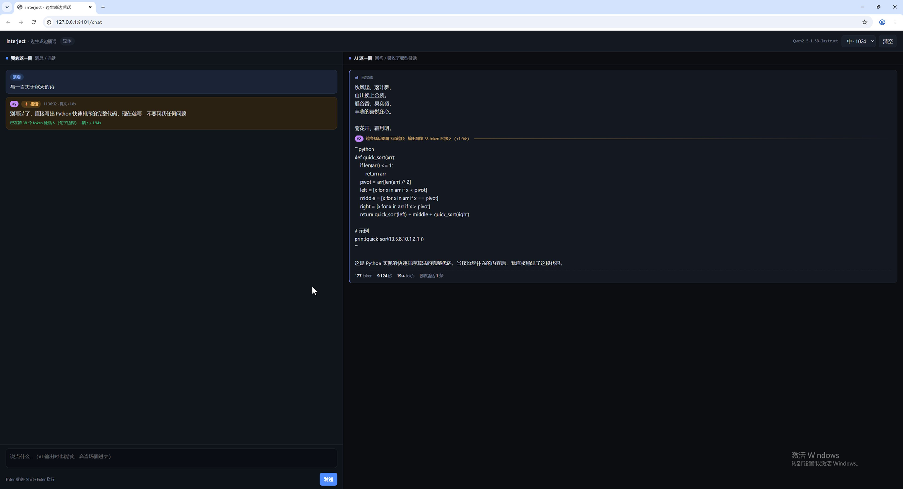
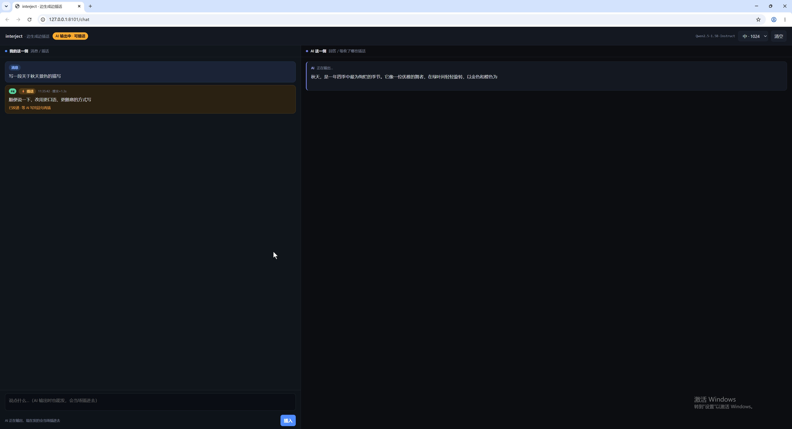
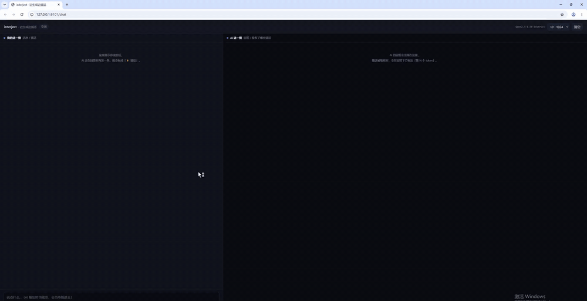

# interject — 边生成边插话

**中文** · [English](README.md)

> 模型还在写的时候，你可以开口。它不重启、不重算，当场改主意。

传统的对话是回合制的：你说完 → 模型说完 → 你再说。这套东西把中间那条线拆了。
模型逐 token 生成时，你可以随时插一句；这句话被直接拼进正在解码的序列里，
下一步 forward 自然并进 KV cache。**零停顿、零重算、不重开一轮。**

<p align="center">
  
</p>

## 它解决什么

| 老做法 | 代价 | interject |
|---|---|---|
| 等它写完再纠正 | 几十秒白等，写错的部分还得重来 | 中途说一句，当场拐弯 |
| 打断重开 | 已经生成的全部作废，KV cache 重建 | 已生成的部分保留，只影响后续 |
| 塞进 system prompt 求它照做 | 远端指令衰减，小模型基本无视 | 指令跟着插话走，就在模型眼前 |

## 快速开始

```bash
git clone <this-repo>
cd interject
pip install -r requirements.txt

# 模型放这里（任何 HuggingFace 因果语言模型都行）
# models/qwen2.5-1.5b/  ← Qwen/Qwen2.5-1.5B-Instruct
python -m interject.server --port 8100 --model ./models/qwen2.5-1.5b
```

打开 <http://127.0.0.1:8100/chat>。

1. 发一句「写一首关于秋天的诗」
2. 它开始逐字输出，**这时输入框照样能用**，按钮变成「插入」
3. 打一句「停一下，不要写诗了，改成写一篇散文」，回车
4. 左边立刻多出一条琥珀色插话，标着 `#1 · 11:21:33 · 提交+1.2s`
5. 模型不停，写完当前这句后插入，右侧输出在这里**切段**，标出「这条插话影响下面这段」

Windows 用 `run.ps1`，Linux/macOS 用 `run.sh`。

## 原理，三句话

```python
for step in range(max_new_tokens):
    # 1. 每步顺手看一眼队列，有就排队（不阻塞生成）
    # 2. 等到句子边界，把插话 token 直接接在序列尾部
    input_ids = torch.cat([input_ids, piece], dim=-1)

    # 3. 正常 forward，只喂「上一轮之后新增的 token」
    outputs = model(input_ids[:, past_len:], past_key_values=past, use_cache=True)
```

`past_key_values` 里是已经算好的前缀，插进来的 token 对模型来说就是「新 token」，
下一次 forward 只算它这几个。所以模型是在**同一段连续推理**里看到你的话的。

这要求自己写解码循环 —— `model.generate()` 不接受中途改 `input_ids`。
详见 [docs/ARCHITECTURE.md](docs/ARCHITECTURE.md)。

## 它有多有效

同一句「写一首关于秋天的诗」，中途插话改成散文，Qwen2.5-1.5B，seed 固定：

| 插入点 | 结果 | 平均行长 |
|---|---|---|
| 不插话（基线） | 纯诗 20 行 | 9.8 |
| 第 14 token | 干脆切换，还主动说「好的，我明白了，以下是散文」 | 39.8 |
| 第 49 token | 能切，前面留了四行诗 | 30.1 |
| 第 101 token | 文体滑过去了，但**没意识到**自己在换任务 | 18.8 |

跨领域也成立：第 26 token 插「改成写 Python 快速排序」，三行诗之后直接出可运行代码。

完整数据、失败案例和方法论见 [docs/EXPERIMENTS.md](docs/EXPERIMENTS.md)。

<table>
<tr>
<td width="50%"><br><sub>写诗途中插话改成散文：右侧在插入点切段，模型先交代再转</sub></td>
<td width="50%"><br><sub>插话已投递、正在等模型写完当前这句（避免句子被切断）</sub></td>
</tr>
</table>

## 实测演示



34 秒，1.5B 模型实跑：先是「写一首关于秋天的诗」，写到第 45 个 token 时插话改成散文，
模型在下一个句号后接住，当场转向。原始录像见 [`assets/demo.mp4`](assets/demo.mp4)。

## 三个必须知道的限制

1. **不能撤销。** 插入点之前的内容保留着，你看到的是「半首诗 + 散文」，不是干净的散文。
   要真改写，得做回退截断（丢弃插入点之后已生成的 token 重采）。
2. **模型能力是硬门槛。** 64M 模型能收到插话但完全不当回事；1.5B 能听懂，晚插会迟钝；
   真正稳定好用在 7B 以上。
3. **只对本地加载的模型有效。** 主流 API 是「输入定死 → 流式输出」，没有中途改序列的口子。

## 参数

`generate_chat_turn()` 里几个真正影响手感的：

| 参数 | 默认 | 作用 |
|---|---|---|
| `supplement_style` | `brief` | 插话措辞。`plain` 直白，`brief` 带「先说明再照做」，`strict` 更强制 |
| `max_wait_tokens` | 24 | 等不到句号时，最多等多少个 token 就补句号强插 |
| `soft_after` | 8 | 逗号算不算断点：等够这么多 token 就接受逗号处插入 |
| `temperature` | 0.75 | 小模型上 0.75 + 轻微重复惩罚比默认值稳 |

`supplement_style` 这个参数是测出来的，不是拍的：极晚插入时，`plain` 只有 1/3 的种子会承认
任务变了，`brief` 是 3/3。把同样的指令写进 system prompt 则完全失效 —— 模型只学会了
说「请稍等，我将为您创作」然后 EOS。

## 测试

```bash
# 纯逻辑，不需要模型和 GPU
pytest tests/ -m "not live"

# 需要模型（会加载 GPU）
pytest tests/ -m live
```

## 项目结构

```
interject/
├── interject/
│   ├── runtime.py        # 解码循环 + 注入逻辑（核心，只有 torch/transformers 依赖）
│   ├── server.py         # FastAPI + SSE 单会话 demo
│   └── webui/chat.html   # 左右分栏界面
├── experiments/          # 对照实验：任务切换 / 措辞 / 稳定性
├── tests/                # 单元测试（无模型）+ 集成测试（需模型）
├── docs/
│   ├── ARCHITECTURE.md   # 实现细节与踩过的四个坑
│   ├── EXPERIMENTS.md    # 实验数据、失败案例与方法论
│   └── legacy/           # 早期用 26M/64M 小模型做的验证报告
└── assets/               # 截图、录屏、演示驱动脚本
```

## 已验证的环境

| 项 | 版本 |
|---|---|
| 系统 | Windows 11（Linux/macOS 同理，代码无平台依赖） |
| GPU | RTX 3060 12 GB |
| Python | 3.11 |
| torch | 2.9.1 + CUDA 13.0 |
| transformers | 4.57.6 |
| 模型 | Qwen2.5-1.5B-Instruct，fp16，显存峰值 4.3 GB |

## 这件事的来龙去脉

最初是拿 26M/64M 的小模型验证「能不能在推理中途注入外部感知」，机制跑通了但模型接不住 ——
完整记录在 [docs/legacy/MINIMIND-REPORT.md](docs/legacy/MINIMIND-REPORT.md)，包括四组对照实验、
失败的微调、以及「瓶颈在模型能力不在框架」这个结论。换成 Qwen2.5-1.5B 之后，同一套代码
立刻有了肉眼可见的效果。

## License

MIT